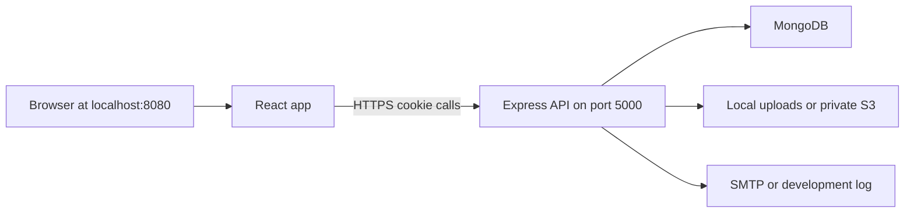

# Rowad Field Guide — CIO Brief

The product in the interface is **Rowad Field Guide**. The API package is `rowad-academy-api`. The repository folder is `skill-craft-desk`.

## 1. Why the company needs it

Site teams do not need another general training portal. They need the correct procedure for the work in front of them: cast-in-place concrete, waterproofing, plumbing, electrical, and the rest of the CSI sections.

Today that knowledge usually lives in PDFs, WhatsApp, personal folders, and whoever happens to be on site. The result is inconsistent method statements, weak inspection records, and lessons learnt that never reach the next project.

The Field Guide is an internal system that puts one approved guide in one place:

- Organized by construction division and specification section, including the CSI code such as `03 30 00`.
- Restricted to verified `@rowad-rme.com` accounts.
- Built so a guide can hold the video, photos, PDF, written instructions, best practices, method statement, inspection test plan (ITP), and lessons learnt together.

## 2. What a user can do today

| Audience | What they get |
| --- | --- |
| Visitor | Public home page only. Guides stay behind login. |
| Employee | Register with a company email, verify the mailbox, then use Library, a personal dashboard, and a lesson page. |
| Admin | Create categories, publish guides, upload video, images, and PDF, and activate or deactivate users. |

A lesson page has these tabs: Video, Gallery, PDF, Instructions, Best Practices, Method Statement, ITP, and Lesson Learnt.

Opening a guide records a view, so the dashboard can show recently viewed procedures.

## 3. How it is built

Two programs must run together. The website is the frontend on port **8080**. The API is the backend on port **5000**. The browser never talks to the database directly.

| Layer | Choice | Why it was chosen |
| --- | --- | --- |
| Interface | React 19, TypeScript, Vite 8, React Router 7 | Fast internal web app, no app-store release |
| Visual system | Tailwind CSS 4, Radix UI, Lucide icons | Consistent screens without a custom design system |
| API | Node.js, Express 4 | Small team, same language as the frontend |
| Database | MongoDB through Mongoose 8 | Guides have mixed text, lists, and file references |
| Login | JWT in an HTTP-only cookie, bcrypt passwords | The token is not readable by page scripts |
| Mail | Nodemailer | Company-email verification before first login |
| Files | Multer, then local disk or AWS S3 | Private files; reads return short-lived links |
| Validation | express-validator, Zod on forms | Reject bad input before it is stored |

Main API groups are `/api/auth`, `/api/categories`, `/api/lessons`, `/api/progress`, and `/api/users`. `/health` confirms the API process is up.

## 4. Security choices worth stating to the CIO

- Only `@rowad-rme.com` addresses can register or sign in.
- A new account cannot sign in until the employee opens a signed verification link. A new link cancels older ones, and resend has a cooldown.
- The session cookie is HTTP-only. JavaScript on the page cannot read it.
- The API accepts browser calls only from the configured frontend address, and only with credentials.
- Admin screens are blocked unless the account role is `admin`. The first admin is created with a one-time script, not from the public signup page.
- Passwords are stored as hashes. Video, image, and PDF records store a file key, not a permanent public URL. When storage is S3, each view gets a fresh link that expires in one hour.
- An admin can deactivate a user without deleting the account.

## 5. Obstacles we actually hit

**The API was not running.** The page called `http://localhost:5000` and the browser showed `ERR_CONNECTION_REFUSED`. The website can look healthy while the API is stopped. Both processes have to stay up.

**The database host did not exist on the company network.** The API started, then crashed with `querySrv ENOTFOUND` for `cluster0.txszz1y.mongodb.net`. Company DNS (`CAI-DC1`) reported that hostname as a non-existent domain. Login cannot work until `MONGODB_URI` points at a cluster this network can resolve, and Atlas allows the office IP. There is no local MongoDB or Docker install on the machine we tested.

**The console lines from the latest run are not application failures.**

- `Download the React DevTools` is a development hint from React. It does not affect users.
- `favicon.ico 404` means the browser asked for a site icon and this app does not ship one yet. Cosmetic only.
- `GET /api/auth/me 401` means “no valid login cookie.” The app asks “who is signed in?” on every page load. Logged-out visitors are supposed to get 401, and the screen then shows Sign in. It appears twice because React development mode runs that check twice.

**Content structure was too flat for the specification library.** The first categories were broad labels such as MEP Services and Concrete & Formwork. The library now needs CSI divisions and coded sections, for example Division 03 and `03 30 00 Cast-in-Place Concrete`, so the code is visible on the card before anyone opens a guide. That hierarchy is in the data model and seed list. It appears in the live library only after the database is reachable and the category seed is run.

**Email and file storage have two modes.** In development, verification links can be printed in the API terminal instead of sent. Files can stay on local disk. Production needs real SMTP and, if guides leave one server, a private S3 bucket.

## 6. What is still unfinished

- Seed the CSI divisions and sections into the live database and confirm the Library flow: division card, then section cards with codes, then guides.
- Point guides that were filed under the old categories at the correct specification section.
- Add a real favicon so the 404 disappears.
- Production hosting, backups, SMTP, and a MongoDB address that company DNS can resolve.
- Automated tests and a deployment pipeline are not in the repository yet.

## 7. Future enhancements

1. Company single sign-on, so employees use the existing directory instead of a separate password.
2. Search across guide text, CSI codes, and attachments.
3. Approval workflow: draft, technical review, publish, and a visible revision history for method statements and ITPs.
4. Phone layout and offline copies for sites with weak signal, including a QR code on the drawing or the work area.
5. Usage reporting for the CIO: which sections are opened, which projects never open the ITP, and where lessons learnt are missing.
6. Arabic and English on the same guide.
7. Required acknowledgement: the user confirms they read the current method statement before the work starts.
8. Linking a guide to project, zone, and subcontractor, not only to a specification section.

## 8. Suggested close

The Field Guide is the company’s controlled place for how work is actually done. It is already a two-part web system with company-email login, role-based administration, and a lesson that can hold the procedure, the inspection plan, and the lesson learnt together. The remaining gate is operational: a database the office network can reach, both servers running, and the CSI library loaded. After that, the useful investment is approval, search, and site access, not another rewrite.
